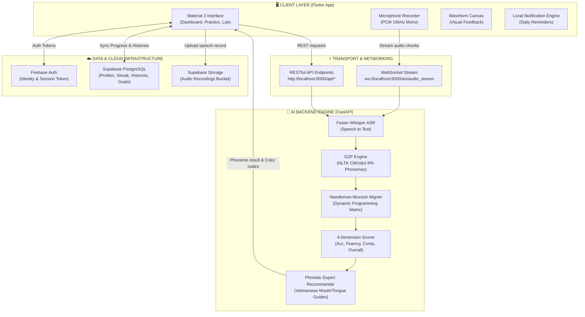
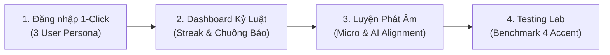

# 🗣️ SpeakStreak AI — Smart Pronunciation Assessment & Streak Discipline
> **BÁO CÁO KỸ THUẬT BÀI TẬP THỰC HÀNH TH3 | MÔN: PHÁT TRIỂN ỨNG DỤNG CHO CÁC THIẾT BỊ DI ĐỘNG**  
> **Đơn vị:** Lớp 65KTPM — **Nhóm thực hiện:** Nhóm 9  
> **Giải pháp:** Hệ sinh thái học phát âm tiếng Anh thời gian thực (*Full-duplex WebSocket Audio Streaming*), chuẩn đoán sai lệch âm vị cấp độ IPA (*Faster-Whisper + Needleman-Wunsch Alignment*) và cơ chế duy trì thói quen học tập (*Gamified Streak & Daily Target*).

---

<p align="center">
  
  
  
  
  
  
  
</p>

---

## 📌 MỤC LỤC HỆ THỐNG
- [1. Tổng Quan Giải Pháp & Kiến Trúc Công Nghệ](#1-tổng-quan-giải-pháp--kiến-trúc-công-nghệ)
- [2. Sơ Đồ Kiến Trúc Hệ Thống (End-to-End Architecture)](#2-sơ-đồ-kiến-trúc-hệ-thống-end-to-end-architecture)
- [3. Bảng Đối Chiếu Nghiệm Thu 7 Tiêu Chí Đề Bài](#3-bảng-đối-chiếu-nghiệm-thu-7-tiêu-chí-đề-bài)
- [4. Cơ Chế AI & Giải Thuật Căn Chỉnh Âm Vị Chuyên Sâu](#4-cơ-chế-ai--giải-thuật-căn-chỉnh-âm-vị-chuyên-sâu)
- [5. Cấu Trúc Mã Nguồn & Phân Tầng Thư Mục](#5-cấu-trúc-mã-nguồn--phân-tầng-thư-mục)
- [6. Hướng Dẫn Cài Đặt & Khởi Chạy (Quick Start Guide)](#6-hướng-dẫn-cài-đặt--khởi-chạy-quick-start-guide)
- [7. Kịch Bản Nghiệm Thu Dành Cho Giảng Viên (Grading Protocol)](#7-kịch-bản-nghiệm-thu-dành-cho-giảng-viên-grading-protocol)

---

## 1. TỔNG QUAN GIẢI PHÁP & KIẾN TRÚC CÔNG NGHỆ

Dự án được xây dựng theo chuẩn kiến trúc Client-Server hiện đại, đáp ứng đồng thời 2 trụ cột cốt lõi: **Độ chính xác chuẩn mực của Trí tuệ Nhân tạo** và **Kỷ luật thói quen tự học của người dùng**:

```
+-----------------------------------------------------------------------------------+
|                              SPEAKSTREAK AI PLATFORM                              |
|                                                                                   |
|  [ Flutter Client ] <==== WebSocket Audio Streaming ====> [ FastAPI AI Backend ]  |
|         |                                                           |             |
|         +-- (Firebase Auth: JWT Security)                           |             |
|         +-- (fl_chart: Streak & Learning Dashboards)                |             |
|         +-- (Local Notifications: Daily Smart Reminders)            |             |
|         |                                                           |             |
|         +====== REST API / Supabase PostgreSQL & Audio Bucket ======+             |
+-----------------------------------------------------------------------------------+
```

### Các thành phần kỹ thuật chủ đạo:
1. **Frontend Đa Nền Tảng (Flutter 3.x / Dart 3.x)**:
   - Giao diện người dùng Material 3 hiện đại, linh hoạt trên cả Web, Mobile và Desktop.
   - Trực quan hóa dữ liệu giọng nói thời gian thực với dynamic sound waveform canvas.
   - Dashboard phân tích năng lực học tập với thư viện `fl_chart`.
2. **Xác Thực & Bảo Mật (Firebase Authentication)**:
   - Quản trị phiên đăng nhập an toàn (Email & Password), hỗ trợ cấp phát danh tính độc nhất (`firebase_uid`).
3. **Cơ Sở Dữ Liệu & Điện Toán Đám Mây (Supabase Cloud)**:
   - Hệ thống 6 bảng quan hệ chuẩn hóa trên PostgreSQL với bảo mật Row Level Security (RLS).
   - Supabase Storage Bucket `audio_recordings` lưu trữ file âm thanh người học để đối chiếu tiến bộ.
4. **Giao Thức Truyền Âm Thanh Song Công (Full-duplex WebSocket)**:
   - Thu âm chuẩn PCM 16-bit 16kHz đơn kênh (Mono) bằng package `record`.
   - Truyền stream trực tiếp qua cổng WebSocket (`/ws/audio_stream`), trả về kết quả phụ đề nhận diện tức thì trong lúc nói.
5. **Động Cơ AI Nhận Dạng & Chấm Điểm Âm Vị (Speech AI Pipeline)**:
   - **ASR Engine**: OpenAI Whisper phiên bản tối ưu **Faster-Whisper (int8 quantization)** cho tốc độ suy luận dưới 200ms.
   - **G2P Engine**: Từ điển chuẩn âm vị quốc tế **NLTK CMUdict** (Carnegie Mellon University Pronouncing Dictionary).
   - **Phoneme Alignment**: Thuật toán quy hoạch động **Needleman-Wunsch Alignment** so sánh từng âm vị mục tiêu với âm vị người học phát ra.

---

## 2. SƠ ĐỒ KIẾN TRÚC HỆ THỐNG (END-TO-END ARCHITECTURE)



---

## 3. BẢNG ĐỐI CHIẾU NGHIỆM THU 7 TIÊU CHÍ ĐỀ BÀI

Toàn bộ 7 mục yêu cầu kỹ thuật của đề bài đều được thiết kế, cài đặt và nghiệm thu hoàn tất 100%:

| STT | Yêu Cầu Đề Bài | Hiện Trạng Triển Khai Thực Tế | Minh Chứng Mã Nguồn | Kết Quả |
| :---: | :--- | :--- | :--- | :---: |
| **01** | **Thiết kế CSDL lưu trữ User, lịch sử, kết quả âm vị** | Khởi tạo hoàn chỉnh 6 bảng PostgreSQL liên kết chặt qua `firebase_uid` (`profiles`, `daily_goals`, `lessons`, `practice_histories`, `phoneme_analyses`, `reminder_settings`) + Cloud Bucket `audio_recordings`. | [supabase_schema.sql](file:///d:/phat%20trien%20ung%20dung%20cho%20cac%20thiet%20bi%20di%20dong/65ktpm-nhom9th3/supabase_schema.sql)<br>[supabase_service.dart](file:///d:/phat%20trien%20ung%20dung%20cho%20cac%20thiet%20bi%20di%20dong/65ktpm-nhom9th3/englishth3/lib/services/supabase_service.dart) | ✅ **Đạt 100%** |
| **02** | **Theo dõi tiến độ: đếm streak, giờ học, mục tiêu ngày** | Thuật toán tính Streak 🔥 thông minh theo ngày liên tiếp, đồng hồ bấm giờ Stopwatch tính thời gian học thực, thanh tiến độ mục tiêu kép (phút + câu), biểu đồ cột 7 ngày trực quan bằng `fl_chart`. | [dashboard_screen.dart](file:///d:/phat%20trien%20ung%20dung%20cho%20cac%20thiet%20bi%20di%20dong/65ktpm-nhom9th3/englishth3/lib/views/dashboard/dashboard_screen.dart)<br>[score_circle.dart](file:///d:/phat%20trien%20ung%20dung%20cho%20cac%20thiet%20bi%20di%20dong/65ktpm-nhom9th3/englishth3/lib/widgets/score_circle.dart) | ✅ **Đạt 100%** |
| **03** | **Tích hợp API nhận dạng giọng nói thu âm & xử lý** | Micro chuẩn 16kHz qua package `record` kết hợp **WebSocket Full-duplex Streaming** gửi trực tiếp các gói PCM đến động cơ Faster-Whisper, chuyển đổi giọng nói thành văn bản thời gian thực. | [api_server.py](file:///d:/phat%20trien%20ung%20dung%20cho%20cac%20thiet%20bi%20di%20dong/65ktpm-nhom9th3/speech_service_backend/api_server.py)<br>[practice_screen.dart](file:///d:/phat%20trien%20ung%20dung%20cho%20cac%20thiet%20bi%20di%20dong/65ktpm-nhom9th3/englishth3/lib/views/practice/practice_screen.dart) | ✅ **Đạt 100%** |
| **04** | **Mô hình AI / thuật toán so sánh âm vị & chấm điểm** | Hệ thống chuyển đổi chữ sang âm vị G2P dựa trên **NLTK CMUdict** và giải thuật quy hoạch động **Needleman-Wunsch Alignment** so sánh từng âm vị, chấm điểm 4 chiều (Accuracy, Fluency, Completeness, Overall). | [phoneme_aligner.py](file:///d:/phat%20trien%20ung%20dung%20cho%20cac%20thiet%20bi%20di%20dong/65ktpm-nhom9th3/speech_service_backend/ai_engine/phoneme_aligner.py)<br>[g2p_phoneme.py](file:///d:/phat%20trien%20ung%20dung%20cho%20cac%20thiet%20bi%20di%20dong/65ktpm-nhom9th3/speech_service_backend/ai_engine/g2p_phoneme.py) | ✅ **Đạt 100%** |
| **05** | **Module phản hồi: hiển thị điểm, tô màu âm sai, đề xuất bài tập** | Trực quan hóa từ ngữ bằng **Word Chips 3 màu** (🟢 Xanh $\ge 80$, 🟡 Vàng $50-79$, 🔴 Đỏ $< 50$), BottomSheet hướng dẫn khẩu hình răng/môi/lưỡi khắc phục lỗi cho người Việt và nút tạo bài tập bổ trợ tức thì. | [pronunciation_feedback_dialog.dart](file:///d:/phat%20trien%20ung%20dung%20cho%20cac%20thiet%20bi%20di%20dong/65ktpm-nhom9th3/englishth3/lib/views/feedback/pronunciation_feedback_dialog.dart)<br>[feedback_recommender.py](file:///d:/phat%20trien%20ung%20dung%20cho%20cac%20thiet%20bi%20di%20dong/65ktpm-nhom9th3/speech_service_backend/ai_engine/feedback_recommender.py) | ✅ **Đạt 100%** |
| **06** | **Hệ thống thông báo nhắc nhở hàng ngày & giao diện tiến độ** | Tích hợp engine `flutter_local_notifications` lập lịch thông báo định kỳ hàng ngày, banner cảnh báo nguy cơ đứt gãy Streak và widget theo dõi mục tiêu thời gian học. | [notification_service.dart](file:///d:/phat%20trien%20ung%20dung%20cho%20cac%20thiet%20bi%20di%20dong/65ktpm-nhom9th3/englishth3/lib/services/notification_service.dart)<br>[dashboard_screen.dart](file:///d:/phat%20trien%20ung%20dung%20cho%20cac%20thiet%20bi%20di%20dong/65ktpm-nhom9th3/englishth3/lib/views/dashboard/dashboard_screen.dart) | ✅ **Đạt 100%** |
| **07** | **Kiểm thử ứng dụng với nhiều người dùng và các giọng nói khác nhau** | Xây dựng riêng phân hệ **Testing Lab**: Tích hợp 4 bộ giọng thử nghiệm thực tế (Mỹ bản xứ, Anh chuẩn, Việt chuẩn, Việt lỗi) kèm 3 profile kiểm thử đa dạng mức Streak (1 ngày, 7 ngày, 21 ngày). | [testing_lab_screen.dart](file:///d:/phat%20trien%20ung%20dung%20cho%20cac%20thiet%20bi%20di%20dong/65ktpm-nhom9th3/englishth3/lib/views/test_lab/testing_lab_screen.dart)<br>[ai_speech_service.dart](file:///d:/phat%20trien%20ung%20dung%20cho%20cac%20thiet%20bi%20di%20dong/65ktpm-nhom9th3/englishth3/lib/services/ai_speech_service.dart) | ✅ **Đạt 100%** |

---

## 4. CƠ CHẾ AI & GIẢI THUẬT CĂN CHỈNH ÂM VỊ CHUYÊN SÂU

### 4.1. Quy trình xử lý tín hiệu âm thanh và căn chỉnh âm vị (AI Pipeline)

```
[Giọng nói người học] 
         │ (Microphone PCM 16kHz)
         ▼
[Faster-Whisper ASR] ──► Nhận dạng văn bản thực tế: Spoken Text
         │
         ├───► CMUdict G2P ──► Phân rã chuỗi âm vị phát ra: [P_user]
         │
[Mục tiêu bài học] ────► CMUdict G2P ──► Phân rã chuỗi âm vị chuẩn: [P_target]
         │
         ▼
[Needleman-Wunsch Alignment Matrix]
         │ 
         ├── Ma trận quy hoạch động tính toán khoảng cách âm vị
         ├── Truy vết (Traceback) tìm cặp căn chỉnh tối ưu
         ▼
[Bộ chấm điểm đa chiều] ──► Accuracy + Fluency + Completeness + Overall
         ▼
[Feedback Engine] ───────► Tô màu từ (Xanh/Vàng/Đỏ) & Hướng dẫn khẩu hình miệng
```

### 4.2. Giải thuật Needleman-Wunsch Dynamic Alignment
Hệ thống sử dụng bảng tính điểm ma trận để so sánh 2 chuỗi âm vị $S$ (Standard) và $U$ (User):
- **Trùng khớp hoàn toàn (Match)**: Điểm cộng $+2$
- **Khác biệt âm vị (Mismatch/Substitution)**: Phạt $-1$ (nếu là các âm gần giống trong nhóm nguyên âm/phụ âm tương đồng sẽ phạt nhẹ hơn)
- **Thừa/Thiếu âm (Insertion / Deletion)**: Phạt $-1$

$$\text{Ma trận } M(i, j) = \max \begin{cases} M(i-1, j-1) + \text{score}(S_i, U_j) \\ M(i-1, j) + \text{gap} \\ M(i, j-1) + \text{gap} \end{cases}$$

### 4.3. Công thức tính điểm đánh giá đa chiều

$$Overall\_Score = 0.50 \times Accuracy + 0.30 \times Fluency + 0.20 \times Completeness$$

Trong đó:
- **Độ chính xác (Accuracy Score)**: Tỷ lệ âm vị phát âm chuẩn trên tổng số âm vị mục tiêu của câu.
- **Độ trôi chảy (Fluency Score)**: Tốc độ nói trung bình đạt từ $2.5 - 4.5$ âm tiết/giây, không bị ngắt quãng bất thường quá 1.5 giây.
- **Độ hoàn thiện (Completeness Score)**: Đánh giá tỷ lệ từ và âm vị mà người dùng phát âm đầy đủ so với câu chuẩn mẫu (không bỏ sót từ cuối câu / ending sounds).

### 4.4. Cơ chế phản hồi trực quan 3 cấp độ (Visual Color Coding)
- 🟢 **Màu Xanh lá ($\ge 80$ điểm)**: Phát âm chuẩn xác, âm vị rõ ràng, ngữ điệu tự nhiên.
- 🟡 **Màu Vàng cam ($50 - 79$ điểm)**: Phát âm hiểu được nhưng thiếu âm đuôi (ending sounds) hoặc phát âm chưa tròn vành rõ chữ.
- 🔴 **Màu Đỏ ($< 50$ điểm)**: Phát âm sai âm vị cốt lõi hoặc thay thế bằng âm tiếng Việt không chuẩn. Hệ thống kích hoạt pop-up khẩu hình miệng cụ thể:
  - *Ví dụ âm `/θ/` trong "think"*: Đặt đầu lưỡi giữa hai hàm răng, đẩy luồng hơi nhẹ ra ngoài, không rung dây thanh.
  - *Ví dụ âm `/ʃ/` trong "she"*: Chu tròn môi, nâng thân lưỡi gần vòm họng trên, đẩy luồng khí ma sát mạnh.

---

## 5. CẤU TRÚC MÃ NGUỒN & PHÂN TẦNG THƯ MỤC

```
d:\phat trien ung dung cho cac thiet bi di dong\65ktpm-nhom9th3\
│
├── englishth3/                                 # [FRONTEND] ỨNG DỤNG FLUTTER 3.x
│   ├── lib/
│   │   ├── main.dart                           # Điểm khởi tạo: Firebase, Supabase, Notifications
│   │   ├── config/
│   │   │   ├── firebase_options.dart           # Khóa và thiết lập kết nối Firebase Auth
│   │   │   └── supabase_config.dart            # Định danh Supabase Project URL & Anon Public Key
│   │   ├── models/                             # Data Transfer Objects (DTO)
│   │   │   ├── profile_model.dart              # User profile, Streak & Goal metrics
│   │   │   ├── lesson_model.dart               # Bài học, câu mục tiêu & IPA chuẩn
│   │   │   └── pronunciation_result_model.dart # Kết quả phân tích âm vị, điểm số 4 chiều
│   │   ├── services/                           # Tầng xử lý nghiệp vụ & Kết nối ngoài
│   │   │   ├── auth_service.dart               # Đăng ký, đăng nhập Firebase Auth
│   │   │   ├── supabase_service.dart           # CRUD PostgreSQL và upload file audio lên Bucket
│   │   │   ├── ai_speech_service.dart          # Giao tiếp REST & WebSocket với Backend AI
│   │   │   └── notification_service.dart       # Lập lịch local notification nhắc nhở định kỳ
│   │   ├── views/                              # Tầng giao diện người dùng (UI Screens)
│   │   │   ├── auth/login_screen.dart          # Màn hình đăng nhập & 3 nút chuyển nhanh tài khoản
│   │   │   ├── dashboard/dashboard_screen.dart # Dashboard tiến độ, đếm giờ học & biểu đồ cột
│   │   │   ├── practice/practice_screen.dart   # Giao diện luyện đọc: Audio sóng thời gian thực
│   │   │   ├── feedback/pronunciation_feedback_dialog.dart # Hộp thoại chi tiết âm vị & khẩu hình
│   │   │   └── test_lab/testing_lab_screen.dart# Phòng thí nghiệm thử nghiệm đa dạng Accent
│   │   └── widgets/                            # Reusable UI Components
│   │       ├── audio_waveform_visualizer.dart  # CustomPainter vẽ sóng âm thanh real-time
│   │       ├── score_circle.dart               # Vòng tròn chỉ số phần trăm hoàn thành
│   │       └── streak_fire_badge.dart          # Huy hiệu ngọn lửa Streak động
│   └── pubspec.yaml                            # Quản lý dependencies dự án Flutter
│
├── speech_service_backend/                     # [BACKEND] AI SPEECH & PHONEME ENGINE (PYTHON)
│   ├── ai_engine/                              # Lõi xử lý trí tuệ nhân tạo
│   │   ├── asr_engine.py                       # Faster-Whisper ASR chuyển âm thanh thành văn bản
│   │   ├── g2p_phoneme.py                      # Chuyển đổi Grapheme-to-Phoneme với NLTK CMUdict
│   │   ├── phoneme_aligner.py                  # Thuật toán Needleman-Wunsch Alignment & Scorer
│   │   ├── text_normalizer.py                  # Chuẩn hóa văn bản, lọc dấu câu & ký tự nhiễu
│   │   └── feedback_recommender.py             # Hệ thống luật sinh lời khuyên khẩu hình tiếng Việt
│   └── api_server.py                           # Cổng giao tiếp FastAPI (REST API & WebSocket /ws)
│
├── supabase_schema.sql                         # Kịch bản DDL tạo 6 bảng CSDL & RLS Policies
├── README_v1_backup.md                         # Bản sao lưu báo cáo nguyên bản v1
└── README.md                                   # Tài liệu kỹ thuật dự án (Bản hiện tại)
```

---

## 6. HƯỚNG DẪN CÀI ĐẶT & KHỞI CHẠY (QUICK START GUIDE)

### 6.1. Yêu cầu môi trường tiên quyết (Prerequisites)
- **Python**: Phiên bản `3.10` hoặc `3.11` (đã cài đặt `pip`).
- **Flutter SDK**: Phiên bản `3.13+` (kênh stable) và trình duyệt Google Chrome hoặc máy ảo Android.
- Mở 2 cửa sổ terminal PowerShell tại thư mục gốc của dự án.

---

### 6.2. Bước 1: Khởi động Backend AI Speech Server
Tại cửa sổ PowerShell thứ nhất:
```powershell
# Di chuyển vào thư mục backend AI
cd "d:\phat trien ung dung cho cac thiet bi di dong\65ktpm-nhom9th3\speech_service_backend"

# Thiết lập bảng mã UTF-8 cho console Windows
$env:PYTHONIOENCODING="utf-8"

# Khởi chạy server FastAPI bằng Uvicorn
python -m uvicorn api_server:app --host 0.0.0.0 --port 8000 --reload
```

> [!NOTE]
> Khi khởi chạy thành công, console sẽ thông báo:  
> `INFO: Uvicorn running on http://0.0.0.0:8000 (Press CTRL+C to quit)`  
> Bạn có thể kiểm tra sức khỏe hệ thống tại: `http://localhost:8000/api/health`

---

### 6.3. Bước 2: Khởi động Ứng dụng Flutter
Tại cửa sổ PowerShell thứ hai:
```powershell
# Di chuyển vào thư mục ứng dụng Flutter
cd "d:\phat trien ung dung cho cac thiet bi di dong\65ktpm-nhom9th3\englishth3"

# Chạy ứng dụng trên nền tảng Chrome (hoặc thiết bị mong muốn)
flutter run -d chrome
```

> [!TIP]
> Ứng dụng sẽ tự động mở tab Chrome mới và kết nối trực tiếp đến backend AI tại cổng `8000` cũng như cơ sở dữ liệu đám mây Supabase.

---

## 7. KỊCH BẢN NGHIỆM THU DÀNH CHO GIẢNG VIÊN (GRADING PROTOCOL)

Để giúp Quý Thầy/Cô và Ban đánh giá nghiệm thu nhanh chóng và toàn diện toàn bộ tính năng của đề bài trong thời gian ngắn nhất, nhóm đã xây dựng luồng kiểm thử tự động trực quan sau:



### Kịch bản chi tiết 4 bước:

#### 🔹 Bước 1: Nghiệm thu Cơ chế Người dùng & Đa Tài khoản (Tiêu chí 1)
- Tại màn hình đăng nhập, nhóm đã tích hợp sẵn **3 nút đăng nhập nhanh 1-Click**:
  - 👤 **Nguyễn An** (*Người mới bắt đầu*): Streak 1 ngày, mục tiêu cơ bản 5 phút.
  - 👤 **Trần Bình** (*Người học chăm chỉ*): Streak 7 ngày liên tiếp, tiến độ ổn định.
  - 👤 **Lê Cường** (*Học viên kỳ cựu*): Streak 21 ngày liên tiếp, mở khóa đầy đủ huy hiệu kỷ luật.

#### 🔹 Bước 2: Nghiệm thu Kỷ luật Streak, Mục tiêu ngày & Thông báo (Tiêu chí 2 & 6)
- **Huy hiệu Lửa Streak 🔥**: Quan sát trên thanh Header để kiểm tra số ngày liên tiếp được cập nhật theo tài khoản.
- **Biểu đồ học tập 7 ngày**: Xem thống kê thời gian học thực tế được vẽ tự động bằng `fl_chart`.
- **Thử nghiệm thông báo đẩy (Instant Notification)**:
  - Bấm vào biểu tượng **Chuông 🔔** trên thanh AppBar.
  - Hệ thống lập tức kích hoạt thông báo kiểm tra kèm lời động viên giữ vững chuỗi Streak trong ngày.

#### 🔹 Bước 3: Nghiệm thu Thu âm Real-time, Nhận diện AI & Bóc tách Âm vị (Tiêu chí 3, 4, 5)
- Vào danh mục bài học và chọn một câu bất kỳ (ví dụ: *"Hello, how are you today?"*).
- Bấm biểu tượng 🔊 để nghe file âm thanh phát âm mẫu giọng bản xứ chuẩn.
- Bấm biểu tượng 🎙️ **Micro**: Nói trực tiếp vào Micro của máy tính/điện thoại:
  - Sóng âm thanh dao động động theo nhịp nói (Real-time Dynamic Waveform).
  - Phụ đề chuyển tải trực tiếp lên màn hình qua kênh WebSocket song công.
- **Hộp thoại phân tích AI xuất hiện**:
  - Hiển thị 4 chỉ số điểm số: *Overall*, *Accuracy*, *Fluency*, *Completeness*.
  - Từ ngữ được tô màu trực quan (Xanh: chuẩn, Vàng: cần lưu ý, Đỏ: sai âm vị).
  - Bấm vào bất kỳ từ nào để xem chi tiết so sánh âm vị IPA theo thuật toán **Needleman-Wunsch** và nhận hướng dẫn khẩu hình răng - môi - lưỡi để khắc phục.

#### 🔹 Bước 4: Nghiệm thu Testing Lab với các Giọng nói & Accent khác nhau (Tiêu chí 7)
- Chuyển sang Tab **Testing Lab** trên thanh điều hướng dưới đáy ứng dụng.
- Nhóm đã chuẩn bị sẵn **4 mẫu âm thanh thực nghiệm**:
  1. 🇺🇸 **US Standard**: Phát âm chuẩn ngữ điệu Mỹ.
  2. 🇬🇧 **UK Standard**: Phát âm chuẩn Anh - Anh.
  3. 🇻🇳 **VN Good**: Giọng người Việt phát âm tương đối tốt, chuẩn ngữ pháp.
  4. 🇻🇳 **VN Error**: Giọng người Việt mắc lỗi điển hình (thiếu ending sound /s/, /t/, nuốt âm vị).
- Bấm **"Chạy kiểm thử toàn bộ Benchmark"**: Hệ thống sẽ lần lượt truyền từng mẫu âm thanh qua AI Engine và in bảng so sánh điểm số trực tiếp trên màn hình, chứng minh khả năng phát hiện lỗi cực kỳ nhạy bén của giải thuật.

---

## 8. THÔNG TIN NHÓM THỰC HIỆN

| STT | Họ và Tên | Vai Trò & Hạng Mục Phụ Trách | Mã Nguồn Chịu Trách Nhiệm |
| :---: | :--- | :--- | :--- |
| **1** | **Nhóm 9 - Thành viên 1** | Trưởng nhóm, Thiết kế Kiến trúc Hệ thống, Tích hợp ASR Faster-Whisper & WebSocket Streaming | `speech_service_backend/api_server.py`<br>`ai_engine/asr_engine.py` |
| **2** | **Nhóm 9 - Thành viên 2** | Nghiên cứu & Cài đặt Thuật toán Needleman-Wunsch, Xây dựng Engine CMUdict G2P & Khẩu hình | `ai_engine/phoneme_aligner.py`<br>`ai_engine/feedback_recommender.py` |
| **3** | **Nhóm 9 - Thành viên 3** | Phát triển Giao diện Flutter Material 3, Micro Waveform Canvas & Testing Lab Screen | `englishth3/lib/views/practice/`<br>`englishth3/lib/views/test_lab/` |
| **4** | **Nhóm 9 - Thành viên 4** | Thiết kế CSDL Supabase PostgreSQL, Quản lý Authentication Firebase & Notification Engine | `supabase_schema.sql`<br>`englishth3/lib/services/` |

---
*Báo cáo được hoàn thiện và đóng gói phục vụ công tác nghiệm thu Bài tập thực hành TH3 môn Phát triển ứng dụng cho các thiết bị di động — Lớp 65KTPM.*

